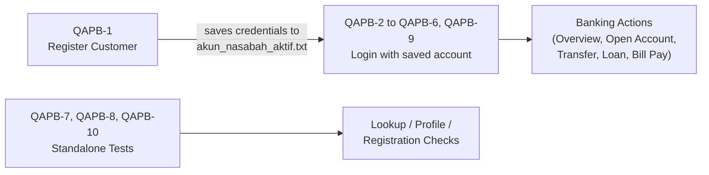

<div align="center">

# 🏦 ParaBank — Full-Cycle Fintech & Banking QA Automation Suite

**Automated end-to-end testing of core online-banking flows, with Jira traceability and real defect detection in security, payments, and compliance.**


[Overview](#-overview) •
[Traceability Matrix](#-jira-requirements-traceability-matrix-rtm) •
[Defects Found](#-defects-found) •
[Getting Started](#-getting-started) •
[Project Structure](#-project-structure) •
[Author](#-author)

</div>

---

## 📌 Overview

This project is a QA automation suite for **[ParaBank by Parasoft](https://parabank.parasoft.com/parabank/index.htm)**, a realistic online-banking demo application built for testing practice.

Each Jira ticket (`QAPB-1` – `QAPB-10`) maps to exactly **one** automated Selenium test, so every requirement and defect can be traced directly to its test script.

| Category | Coverage |
| --- | --- |
| ✅ **Functional (Happy Path)** | Customer registration, account overview, opening accounts, fund transfers, loan applications |
| 🐞 **Defect Detection** | Transaction boundaries, data exposure, KYC validation, payment integrity, AML/duplicate identity |
| 🔗 **Traceability** | 1 Jira ticket ↔ 1 test script, with ticket ID and summary in every file |

### 🔄 Test Flow



---

## 📋 Jira Requirements Traceability Matrix (RTM)

| Jira ID | Banking Module | Test Scenario & Summary | Type | Test Script |
| :--- | :--- | :--- | :---: | :--- |
| **QAPB-1** | Customer Onboarding | Verify successful new customer registration with a complete personal profile | `Task` | [`test_QAPB1_register_nasabah_baru.py`](test_QAPB1_register_nasabah_baru.py) |
| **QAPB-2** | Account Auditing | Verify the account overview displays the active balance and account ID | `Task` | [`test_QAPB2_login_dan_cek_saldo.py`](test_QAPB2_login_dan_cek_saldo.py) |
| **QAPB-3** | Open Account | Verify opening a new secondary Savings account funded from an existing balance | `Task` | [`test_QAPB3_buka_rekening_baru.py`](test_QAPB3_buka_rekening_baru.py) |
| **QAPB-4** | Funds Transfer | Verify real-time fund transfer between customer accounts and balance debiting | `Task` | [`test_QAPB4_transfer_dana_berhasil.py`](test_QAPB4_transfer_dana_berhasil.py) |
| **QAPB-5** | Loan Underwriting | Verify loan application submission and automated credit approval | `Task` | [`test_QAPB5_pengajuan_pinjaman_loan.py`](test_QAPB5_pengajuan_pinjaman_loan.py) |
| **QAPB-6** | Transaction Security | System permits a negative fund transfer amount without validation | `Bug` 🐞 | [`test_QAPB6_bug_transfer_melebihi_saldo.py`](test_QAPB6_bug_transfer_melebihi_saldo.py) |
| **QAPB-7** | Security / Auth | Plaintext password exposure in the Customer Lookup recovery module | `Bug` 🐞 | [`test_QAPB7_bug_password_plaintext_leak.py`](test_QAPB7_bug_password_plaintext_leak.py) |
| **QAPB-8** | KYC Compliance | Update Profile accepts empty/blank mandatory fields without validation | `Bug` 🐞 | [`test_QAPB8_bug_update_profile_blank_fields.py`](test_QAPB8_bug_update_profile_blank_fields.py) |
| **QAPB-9** | Payment Integrity | Bill Pay accepts a negative payment amount | `Bug` 🐞 | [`test_QAPB9_bug_billpay_nominal_negatif.py`](test_QAPB9_bug_billpay_nominal_negatif.py) |
| **QAPB-10** | Anti-Money Laundering | System accepts a duplicate Social Security Number (SSN) during onboarding | `Bug` 🐞 | [`test_QAPB10_bug_registrasi_duplikat_ssn.py`](test_QAPB10_bug_registrasi_duplikat_ssn.py) |

---

## 🐞 Defects Found

| Jira ID | Defect | Test Input | Business Risk |
| :--- | :--- | :--- | :--- |
| **QAPB-6** | Transfer completes with a negative amount | Transfer amount `-500` | Balance manipulation / financial loss |
| **QAPB-7** | Customer Lookup reveals the account password in plaintext | Lookup by customer details | Account takeover / data breach |
| **QAPB-8** | Profile saves with an empty phone number (or the server errors out) | Blank *Phone* field | Loss of verified customer contact data (KYC) |
| **QAPB-9** | Bill payment completes with a negative amount | Bill amount `-75` | Payment fraud / ledger inconsistency |
| **QAPB-10** | A new customer can register with an SSN that already exists | SSN `123456789` | Identity theft / AML non-compliance |

> [!NOTE]
> **Failing bug tests are intentional.** Tests `QAPB-6` – `QAPB-10` check for the *correct, secure* behavior. A failure means the defect is still there, and each one prints a descriptive `[... BUG DITEMUKAN!]` message explaining the issue.

### Expected Results

| Test Group | Tickets | Expected Outcome |
| --- | --- | :-: |
| Functional / Happy Path | `QAPB-1` – `QAPB-5` | ✅ PASS |
| Defect Detection | `QAPB-6` – `QAPB-10` | ❌ FAIL (bug confirmed) |

---

## 🚀 Getting Started

### Prerequisites

- **Python 3.10+** (developed on Python 3.13)
- **Google Chrome** (Selenium 4.6+ downloads the matching ChromeDriver automatically)
- An internet connection (tests run against the live ParaBank demo site)

### Installation

```bash
# 1. Clone the repository
git clone https://github.com/AlifNugraha17/qa-parabank-fintech-automation.git
cd qa-parabank-fintech-automation

# 2. (Optional) Create and activate a virtual environment
python -m venv venv
venv\Scripts\activate        # Windows
# source venv/bin/activate   # macOS / Linux

# 3. Install dependencies
pip install -r requirements.txt
```

### Running the Tests

| Goal | Command |
| --- | --- |
| Run the entire suite | `pytest test_*.py -v -s` |
| Run a single ticket | `pytest test_QAPB4_transfer_dana_berhasil.py -v -s` |
| Run only functional tests | `pytest test_*.py -v -k "not bug"` |
| Run only bug-detection tests | `pytest test_*.py -v -k "bug"` |
| Run a script directly (no pytest) | `python test_QAPB1_register_nasabah_baru.py` |

> [!TIP]
> Run **`QAPB-1` first** in a new session. It registers a fresh customer and saves the credentials to `akun_nasabah_aktif.txt`, which the later tests use to log in. If that file is missing, the tests fall back to ParaBank's default demo account (`john` / `demo`).

> [!WARNING]
> The ParaBank demo server is shared and **resets its database periodically**. If a saved account stops working, run `QAPB-1` again to create a new one.

---

## 📁 Project Structure

```text
qa-parabank-fintech-automation/
├── test_QAPB1_register_nasabah_baru.py            # Customer registration (saves the active account)
├── test_QAPB2_login_dan_cek_saldo.py              # Login & account overview / balance check
├── test_QAPB3_buka_rekening_baru.py               # Open a new Savings account
├── test_QAPB4_transfer_dana_berhasil.py           # Successful fund transfer
├── test_QAPB5_pengajuan_pinjaman_loan.py          # Loan application & approval
├── test_QAPB6_bug_transfer_melebihi_saldo.py      # Bug: negative transfer amount
├── test_QAPB7_bug_password_plaintext_leak.py      # Bug: plaintext password leak
├── test_QAPB8_bug_update_profile_blank_fields.py  # Bug: blank mandatory profile fields
├── test_QAPB9_bug_billpay_nominal_negatif.py      # Bug: negative bill payment
├── test_QAPB10_bug_registrasi_duplikat_ssn.py     # Bug: duplicate SSN registration
├── akun_nasabah_aktif.txt                         # Test account credentials shared between tests
├── requirements.txt                               # pytest, selenium, requests
├── .gitignore
└── README.md
```

---

## 🧰 Tech Stack

| Category | Tools |
| --- | --- |
| Language | Python 3.13 |
| UI Automation | Selenium WebDriver (Chrome) |
| Test Framework | Pytest |
| HTTP Library | Requests |
| Test Management | Jira Software (RTM & defect tracking) |
| Application Under Test | [ParaBank by Parasoft](https://parabank.parasoft.com/parabank/index.htm) |

---

## 👤 Author

**Alif Nugraha** — Quality Assurance Engineer

- GitHub: [@AlifNugraha17](https://github.com/AlifNugraha17)
- Focus: Test Automation · Python · Selenium WebDriver · Jira Software · Fintech & Banking QA

<div align="center">

⭐ If you find this project helpful, feel free to give it a star!

</div>
